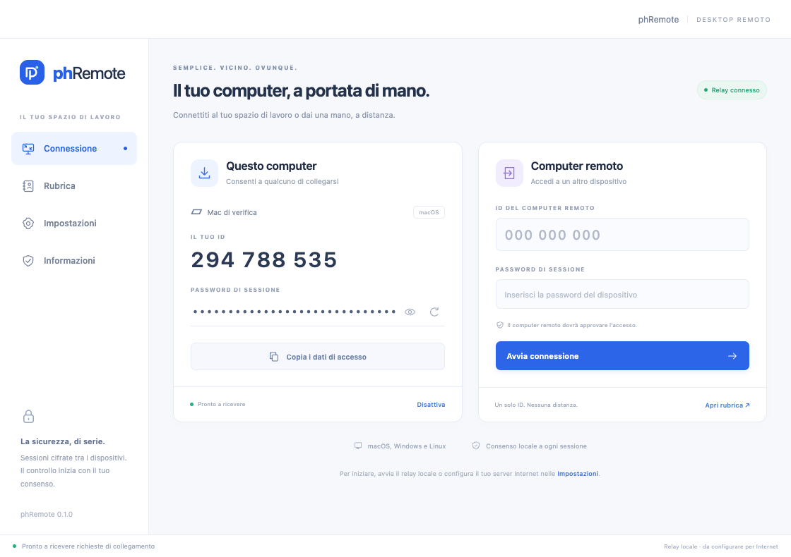

# phRemote

Prima implementazione indipendente di un’app desktop per assistenza remota, con client macOS, Windows e Linux e un relay gestito dall’operatore. Include schermo, mouse e tastiera, chat, appunti su richiesta e rubrica locale. Ogni collegamento richiede password valida e approvazione sul computer che condivide lo schermo.



L’interfaccia e il flusso di collegamento prendono come riferimento l’osservazione di Supremo tramite REA. **phRemote usa un proprio protocollo:** non si collega ai client o ai server Supremo e il protocollo originale non è stato ricostruito. Le osservazioni raccolte si trovano in [research/supremo](research/supremo).

## Avvio dal codice

Richiede Node.js **22.21 o successivo**, consigliato Node 24, e npm. Il runtime desktop è Electron **44.9.0**. Su macOS servono gli Xcode Command Line Tools per compilare il componente di input; il build produce un eseguibile universale arm64/x86_64 con requisito minimo macOS 13.

```sh
npm ci
npm exec install-electron
npm run build:native
```

Apri due terminali dalla radice del progetto:

```sh
# Terminale 1: relay locale
npm run relay
```

```sh
# Terminale 2: applicazione desktop
npm start
```

Il relay locale ascolta su `ws://127.0.0.1:8787/ws`; il controllo salute è `http://127.0.0.1:8787/health`. Il relay non richiede dipendenze npm per funzionare. Su Windows e Linux `build:native` non compila codice: si usano rispettivamente gli helper PowerShell e Python inclusi.

Il comando di avvio rimuove dal solo processo figlio un eventuale ELECTRON_RUN_AS_NODE=1 ereditato dall’editor, così Electron apre l’app desktop. L’ambiente del terminale rimane invariato.

## Collegare due computer

1. Avvia phRemote su entrambi e configura **lo stesso relay** nelle Impostazioni. Il relay loopback serve allo sviluppo sul computer locale; per computer diversi usa un indirizzo `wss://` raggiungibile da entrambi.
2. Sul computer da condividere scegli **Attiva ricezione**. Comunica al destinatario ID di 9 cifre, password e indirizzo del relay; **Copia i dati di accesso** prepara questi dati negli appunti.
3. Sul computer che controlla inserisci ID e password nella scheda **Computer remoto**, poi avvia la connessione.
4. Sul computer da condividere la richiesta diventa approvabile dopo la verifica della password. Scegli **Consenti schermo e controllo**, oppure disabilita il controllo nelle Impostazioni per condividere soltanto lo schermo.
5. Il viewer mostra il desktop remoto. Fai clic sullo schermo per inviare mouse e tastiera. Entrambi possono interrompere la sessione; una riconnessione richiede una nuova approvazione.

La password casuale contiene **32 caratteri**, viene generata all’avvio del client e può essere rigenerata dall’interfaccia. La rubrica salva localmente nomi e ID, senza password. Le identità dei dispositivi sono conservate tramite l’archivio cifrato del sistema; quando questo non è disponibile, compreso il backend Linux `basic_text`, restano soltanto in memoria.

I client usano X25519, prova della password HMAC-SHA256, HKDF-SHA256 e AES-256-GCM, con chiavi diverse per direzione, conferma delle chiavi e rifiuto dei replay. Il relay inoltra i contenuti cifrati. La chat accetta messaggi fino a **4096 caratteri**; gli appunti vengono inviati come testo, mostrati in anteprima e copiati sul destinatario solo con un’azione esplicita.

## Relay Internet e Render

[render.yaml](render.yaml) prepara un Web Service Node 24 a Francoforte, piano `0.5c-512mb`, **una sola istanza** e disco persistente da **1 GB** per conservare le identità. Servizio e disco sono risorse a pagamento: il Blueprint è predisposto localmente, **non è stato pubblicato**. Il repository remoto deve ancora essere creato o scelto e collegato; nessuna risorsa Render o spesa è stata attivata.

Dopo una pubblicazione autorizzata, configura nei client l’indirizzo effettivamente assegnato:

```text
wss://NOME.onrender.com/ws
```

Verifica il servizio su `https://NOME.onrender.com/health`: la risposta prevista è `{"ok":true,"protocolVersion":1}`. Render gestisce TLS e WebSocket. Conserva una sola istanza: presenza e sessioni sono in memoria, mentre il disco mantiene le identità; un riavvio interrompe le sessioni e richiede una nuova approvazione.

La [guida alla pubblicazione](deploy/README.md) descrive Render e l’alternativa Docker/Caddy. La [guida del relay](server/README.md) documenta configurazione, persistenza, limiti e protocollo. I client accettano connessioni non cifrate `ws://` soltanto su loopback; per LAN e Internet è richiesto `wss://` con certificato valido.

## Requisiti e limiti della prima versione

| Piattaforma | Condivisione e controllo |
| --- | --- |
| macOS 13+ | Consenti **Registrazione schermo** per la cattura e **Accessibilità** per mouse/tastiera. Il componente di input non richiede privilegi root. Dopo aver cambiato i permessi può essere necessario riavviare l’app. |
| Windows | Input tramite `SendInput` e helper PowerShell. Un processo non elevato non controlla finestre elevate, schermate UAC o desktop protetti. |
| Linux X11 | Input tramite Python 3, libX11, libXtst, libXrandr e una sessione `DISPLAY` accessibile con RandR 1.5+. Le coordinate seguono il monitor primario e il suo offset fisico; se il primario non è determinabile resta disponibile solo la visualizzazione. |
| Linux Wayland | Sola visualizzazione; la cattura dipende dal portale di sistema. Per mouse e tastiera occorre una sessione X11. |

La cattura invia fotogrammi **JPEG**, con obiettivo di circa **8 fps**, risoluzione massima **1280 × 900** e proporzioni preservate, dal display principale. Qualità e frequenza effettive dipendono da schermo, CPU e rete; non è una pipeline video ottimizzata. La selezione e la gestione di più monitor non sono implementate.

Non sono presenti trasferimento file, audio, stampa remota, accesso non presidiato, account/login o autenticazione a due fattori. Le combinazioni di tasti riservate al sistema locale rimangono gestite da quel sistema. Questa versione non raggiunge la parità funzionale con Supremo.

## Verifica

```sh
npm test
npm run check
npm run test:ui
```

La suite automatica comprende **32 test**: 10 per client/crittografia, 9 per il controller di input con helper simulato, 1 per la geometria Linux (10 casi Python con librerie simulate) e 12 per il relay. Copre, fra l’altro, approvazione obbligatoria, password errata, alterazione dei messaggi, replay, isolamento, riconnessione, persistenza e rilascio dell’input. Il test geometrico richiede Python 3 e viene saltato se non è disponibile. `check` controlla la sintassi JavaScript e Python.

Il test UI eseguito su macOS avvia **Electron reale**, preload e renderer, registra un dispositivo su un relay temporaneo loopback, verifica la rubrica e salva screenshot/report in [research/verification](research/verification). Usa un profilo temporaneo e **non cattura lo schermo né invia input nativo reale**. Non costituisce una prova completa di controllo fra due computer. L’esecuzione desktop e l’input nativo su Windows/Linux non sono ancora stati verificati.

## Creare i pacchetti

```sh
# Piattaforma e architettura correnti
npm run package

# Destinazioni esplicite
npm run package -- --platform darwin --arch arm64
npm run package -- --platform win32 --arch x64
npm run package -- --platform linux --arch x64

# Verificare il pacchetto della piattaforma corrente
npm run test:ui -- --packaged
```

Sono ammesse le architetture `arm64` e `x64`. Il comando riutilizza il runtime Electron locale compatibile oppure scarica quello della destinazione con verifica del checksum. Per macOS il build sul Mac compila il componente di input universale; da altre piattaforme è necessario fornire prima quel componente già compilato.

L’output è `dist/phRemote-PIATTAFORMA-ARCH/`, con `.app` su macOS, `phRemote.exe` su Windows o `phremote` su Linux, più un archivio `.tar.gz` che preserva permessi e link simbolici. Conserva l’intera cartella: sono applicazioni portabili, non installer. Il pacchetto Mac corrente è [dist/phRemote-darwin-arm64/phRemote.app](dist/phRemote-darwin-arm64/phRemote.app).

Su macOS viene applicata una **firma ad hoc** per il build locale: non è una firma Developer ID e il pacchetto **non è notarizzato**. Windows e Linux producono archivi portabili senza una certificazione del produttore. La [CI](.github/workflows/verify.yml) prepara test, controlli e pacchetti su macOS, Windows e Linux, ma non è ancora stata eseguita sul repository remoto.
