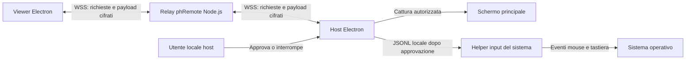

# Supremo: indagine statica e ricostruzione indipendente

Data: 18 ottobre 2026. Applicazione esaminata: **Supremo 4.11.6.2928**,
installata in `/Applications/Supremo.app`.

L'indagine ha identificato il formato dell'applicazione, alcune tecnologie incluse
e una mappa delle funzioni esposte dalle risorse linguistiche. Non ha ricostruito
il protocollo di Supremo né prodotto una decompilazione riuscita delle sue
funzioni. **phRemote è un'implementazione autonoma**, con protocollo, relay e
interfaccia propri; non comunica con i client o i servizi Supremo.

## Artefatti ed evidenze conservate

| Elemento | Identità o percorso |
| --- | --- |
| Eseguibile originale | `/Applications/Supremo.app/Contents/MacOS/Supremo` |
| Dimensione originale | 148.983.920 byte |
| SHA-256 originale | `d3390311f472de55c88fea6ee5ab5c2f12a740cbea6f55445201275f95339152` |
| Formato originale | Mach-O universal, x86_64 e arm64 |
| Copia di analisi | Slice arm64 estratta con `lipo -thin arm64` in una directory temporanea |
| SHA-256 della slice | `7358dda805cbfd10c9f514cd47f7405b767adaf404f5e44dcc5ab9f270f3eec4` |
| Risultati bundle | [bundle-findings.json](./bundle-findings.json): metadati, output degli strumenti e marcatori selezionati |
| Ricevute REA | [rea-observations.json](./rea-observations.json): ricevuta plist e vista sintetica Mach-O |

L'applicazione installata è rimasta invariata. La slice arm64 era una copia
temporanea: eseguibili, librerie, icone e pacchetti di traduzione proprietari non
sono stati copiati nel progetto. I JSON conservano risultati testuali selezionati,
non il codice sorgente di Supremo.

L'analisi ha usato REA e strumenti locali in lettura (`file`, `otool`, `codesign`,
parser plist/INI e ricerca di marcatori). Non sono stati avviati Supremo,
sessioni remote o chiamate ai servizi del produttore; non sono stati letti
configurazioni utente, credenziali o dati della rubrica. Lo screenshot fornito
nella conversazione è stato usato come riferimento visivo delle sezioni e dei
campi, senza riprodurne ID e password.

## Risultati osservati, inferenze e questioni aperte

| Classificazione | Risultato | Base e limite |
| --- | --- | --- |
| Osservato | Versione `4.11.6.2928`, eseguibile `Supremo`, URL scheme `supremo` | `Contents/Info.plist`; lo scheme dichiarato non descrive il formato dei suoi parametri |
| Osservato | Marker compilatore Embarcadero Delphi 36.0, build `29.0.53982.0329` | Stringa incorporata nell'eseguibile, con offset nel JSON bundle |
| Osservato | Identificatori `FMX.Platform.Mac`, `FMX.Forms`, `FMX.Skia` e percorsi `Skia4Delphi` | Presenza letterale; non è una ricostruzione del grafo delle chiamate |
| Inferito | Interfaccia costruita con Delphi FireMonkey e Skia | Coerenza fra marker, nomi delle viste e risorse; codice UI originale non recuperato |
| Osservato | `MacOS/libcgsqlite3_fde.dylib` e `MacOS/libopenh264-osx64.dylib` incluse | La presenza non identifica dati archiviati né codec negoziato in una sessione |
| Osservato | Sparkle 1.27.1 con helper `Frameworks/Sparkle.framework/Versions/A/Resources/Autoupdate.app` | Inventario e plist del framework |
| Osservato | Marker `CGDisplayStream`, `CGEventPost`, `AXIsProcessTrusted`, `WelsCreateSVCEncoder`, `TIdTCPClient` e `TIdTCPConnection` | Ricerca ASCII/UTF-16 nel file; non prova che una specifica funzione li invochi |
| Inferito | Integrazione con API macOS per cattura/input e disponibilità di componenti H.264 | Compatibile con marker e libreria OpenH264; flussi effettivi non verificati |
| Osservato | 30 file lingua `.sil`, in formato INI UTF-8 | Directory `Contents/Resources/Languages`; il file italiano contiene 786 righe e 46 gruppi `TView*` |
| Osservato | Metadati hardened runtime, ticket di notarizzazione e entitlement `com.apple.security.cs.allow-unsigned-executable-memory` | Output `codesign` conservato; non costituisce una verifica completa della catena di firma |
| Sconosciuto | Formato dei messaggi, framing, porte operative, autenticazione e cifratura delle sessioni Supremo | Nessuna traccia di rete, sessione osservata o funzione decompilata |
| Sconosciuto | Regole di rendezvous, collegamento diretto e relay, negoziazione video e gestione concreta degli helper | Nomi e costanti non permettono di stabilire questi comportamenti |

Il plist dichiara macOS minimo `10.11`, aggiornamenti automatici e intervallo di
14.400 secondi. Questi sono metadati distribuiti, non una prova di compatibilità
con tutte le versioni macOS. Analogamente, le descrizioni di accesso a camera,
microfono e altre risorse nel plist non dimostrano che siano usate durante il
controllo remoto. Il campo `ITSAppUsesNonExemptEncryption` non stabilisce la
cifratura del protocollo.

Sono state individuate costanti relative a dispatcher, console, licenze, stato
e aggiornamenti del produttore. Nessun endpoint è stato contattato. La ricerca
letterale non ha trovato `ScreenCaptureKit`, `SCStream`, `TIdUDP` o `RFB 003` nelle
codifiche esaminate: è un risultato circoscritto alla ricerca, non prova di
assenza di tali capacità o di un protocollo equivalente.

## Mappa delle funzioni dalla localizzazione italiana

Fonte: `/Applications/Supremo.app/Contents/Resources/Languages/SupremoX.it.sil`.
I riferimenti seguenti indicano le righe del file installato esaminato; non viene
redistribuita l'intera traduzione. La presenza di una voce prova l'esistenza della
risorsa testuale, non la visibilità o il funzionamento della funzione sul Mac.

| Area | Righe | Informazioni ricavabili |
| --- | --- | --- |
| Navigazione | 444–451 | Connessione, Rubrica, Strumenti e Licenza; coerenti con lo screenshot |
| Connessione | 221–234 | ID locale, password casuale, copia credenziali, ID remoto e comando di connessione |
| Richiesta password | 467–470, 666–671 | Dialogo password e testi per autenticazione a due fattori |
| Autorizzazioni macOS | 83–94, 318–328 | Accessibilità, Registrazione schermo e Accesso completo al disco |
| Rubrica e gruppi | 68–79, 139–192 | Computer, descrizioni, gruppi, ricerca, filtri online/offline, condivisione e permessi |
| Account | 176–184 | Login, recupero password, registrazione e codice 2FA |
| Desktop e barra sessione | 101–105, 391–421 | Riconnessione, fullscreen, scelta monitor, risoluzione, screenshot, qualità e codec |
| Input e appunti | 391–421 | Blocco input, sincronizzazione clipboard e invio degli appunti come tasti |
| Chat | 99–100, 416 | Comandi di invio e accesso alla chat |
| File manager | 121–138 | Pannelli locale/remoto, upload/download, rinomina, eliminazione, cartelle e avanzamento |
| Sicurezza | 280–289, 364–378 | Password aggiuntive, ID ammessi, conferma locale, timeout e 2FA |
| Opzioni e proxy | 290–317 | Lingua, avvio con il sistema, note, proxy HTTP/SOCKS5 e disinstallazione |
| Connessioni attive | 422–443 | Sessioni in ingresso/uscita, chat, trasferimento file e disconnessione |
| Aggiornamenti | 379–390 | Verifica, download, riavvio e scelta canale |
| Licenza e gestione | 193–220, 329–363 | Attivazione, funzionalità Professional e collegamento alla console |
| Codec e qualità | 618–624 | Etichette Legacy/H.264, 8/16 bit e livelli di qualità |

Le risorse contengono anche testi specifici Windows: utente SYSTEM, sessioni RDP,
Ctrl+Alt+Canc, modalità provvisoria e stampante remota. Non sono state assunte
come funzioni disponibili nell'edizione macOS. Anche disponibilità, limiti di
licenza e comportamento delle altre voci restano da verificare in esecuzione.

## Copertura REA e limiti della decompilazione

Il percorso Ghidra usato da REA non ha accettato direttamente il Mach-O universal.
È stata quindi analizzata la copia temporanea arm64 identificata sopra, senza
alterare il bundle installato.

| Operazione | Evidence ID | Copertura conservata |
| --- | --- | --- |
| `inspect_plist` | `ev_264314b5b37faa774135f7cb6ca73b8e10c12b5ccfb3a96c9f8ff6d04e3a4fde` | Ricevuta inline completa, con valore normalizzato e provenienza |
| Vista sintetica di `inspect_macho` | `ev_0be141119b841a22983eeb6ee986cf09cf70717fa38336784c7f6a1b77f05992` | Vista completa entro il proprio ambito, derivata dal record padre |
| Record padre `inspect_macho` | `ev_20b7cda25cadaf3f703721db5b801877b238f85531b6f9d899211f129414f63f` | Identità referenziata; record completo non esportato prima della chiusura del target |

La vista Mach-O riporta **29 dipendenze, 8 segmenti, 1.060 import e 3.751 export**.
Import ed export sono esplicitamente **non esaustivi**: simboli rimossi o nascosti
dalla toolchain possono non comparire. L'esaurimento della vista non prova che
ogni simbolo del programma sia stato recuperato.

L'avvio dell'analisi Ghidra ha superato il budget di **330.000 ms** durante la
ricerca delle funzioni. Non è stata ottenuta una decompilazione riuscita di una
funzione Supremo. Di conseguenza non sono disponibili sorgenti recuperati,
tracciamenti chiamante/chiamato sufficienti a spiegare le funzioni, né una
specifica riproducibile del protocollo originale.

L'esportazione atomica di REA 6.5.0 ha inoltre segnalato errori di identità del
file intermedio e di cleanup sul volume del progetto. `rea-observations.json`
preserva le ricevute inline indicate, ma **non è un bundle canonico completo
della sessione REA**. La sintesi Mach-O è integra; il suo padre completo non è
stato conservato. Questi limiti restano parte delle evidenze e non sono stati
compensati ripetendo l'analisi o attribuendo risultati a tentativi falliti.

## Architettura scelta per phRemote

Il diagramma descrive esclusivamente **il codice di questo progetto**. Non è una
ricostruzione dell'architettura interna di Supremo.

I due client aprono connessioni uscenti verso un relay gestito dall'operatore.
Per LAN/Internet il client richiede `wss://` con TLS valido; `ws://` è consentito
solo su loopback per sviluppo. Il relay va configurato e distribuito su un
server raggiungibile: la presenza del codice non equivale a un servizio pubblico
già attivo. Configurazione e protocollo sono descritti in
[server/README.md](../../server/README.md).

Il protocollo applicativo indipendente usa chiavi effimere **X25519**, prova
password **HMAC-SHA256** legata a identità, richiesta e chiavi pubbliche,
**HKDF-SHA256** per chiavi distinte nelle due direzioni e **AES-256-GCM** per i
payload. Il contesto di autenticazione include sessione, richiesta, direzione e
sequenza; il ricevente rifiuta sequenze duplicate o inattese. Password valida,
approvazione locale obbligatoria e conferma crittografica precedono il traffico
applicativo. Il relay instrada i payload cifrati, ma vede i metadati necessari
alla registrazione e alle richieste. Queste sono proprietà del codice phRemote,
non risultati attribuiti alla cifratura di Supremo.

## Funzioni implementate e differenze di portata

| Area della mappa originale | Implementazione attuale di phRemote | Limite pratico |
| --- | --- | --- |
| ID e password | ID di 9 cifre assegnato dal relay, password casuale locale, rotazione e copia dati d'accesso | ID e credenziali appartengono solo al nostro relay |
| Sessione remota | Richiesta, prova password, approvazione/rifiuto locale, sessione visibile e disconnessione | Una sessione per dispositivo; nessun accesso non presidiato |
| Schermo | Cattura Electron autorizzata e invio di frame JPEG cifrati | Schermo principale, riduzione fino a 1280×900, ciclo obiettivo di circa 8 fps; non H.264 |
| Mouse e tastiera | Helper locali macOS, Windows e Linux X11; coordinate normalizzate e testo | Permessi e limiti del sistema operativo; nessuna elevazione automatica |
| Termine input | Rilascio su stop/EOF, gestione degli errori e tentativo singolo di recupero dopo crash | Se il sistema impedisce il rilascio, viene mostrato un errore; nessuna ripresa automatica del controllo |
| Chat | Messaggi testuali cifrati durante la sessione | Nessun servizio account o archivio cloud |
| Appunti | Invio esplicito del testo e copia locale su conferma del destinatario | Nessuna sincronizzazione automatica, immagini o file negli appunti |
| Rubrica | Contatti locali per nome e ID | Nessun gruppo condiviso, account o sincronizzazione cloud |
| Autorizzazioni | Stato e collegamenti alle impostazioni macOS; fallback in sola visualizzazione | Accessibilità per input e Registrazione schermo per cattura su macOS |
| Trasferimento file | Non implementato | Nessun file manager remoto |
| Funzioni avanzate | Non implementate | Audio, stampante remota, riavvio, cambio ruolo, cambio risoluzione, multimonitor, RDP, 2FA account, console Professional e aggiornamenti automatici |

Su Windows `SendInput` opera senza elevazione: finestre elevate, UAC e desktop
protetto restano fuori dal controllo. Su Linux l'input richiede X11, Python 3,
libX11, libXtst e libXrandr con RandR 1.5 o successivo; le coordinate usano il
monitor primario e il suo offset. Se il primario non è determinabile, o su
Wayland, resta disponibile solo la visualizzazione. Il testo Linux è
limitato ai simboli già disponibili nella mappa X11, senza modificarla.
Questi limiti e il contratto stdin degli helper sono descritti in
[desktop/native/README.md](../../desktop/native/README.md).

Il codice core, il relay e i confini input hanno test dedicati in
[`tests/`](../../tests/). I nove test lifecycle input eseguiti con un helper Node
temporaneo hanno verificato avvio concorrente, revoca durante l'avvio,
validazione, rilasci sotto throttling, EOF, errori e recupero dopo crash senza
inviare input reale. Il sorgente Swift è stato compilato localmente; la sintassi
Python è stata verificata. Questi controlli non sostituiscono una sessione fra
due computer su ogni sistema operativo: l'input reale Windows/Linux e il
funzionamento tramite un relay pubblico richiedono ancora una verifica sul
relativo ambiente. Nessuna parità funzionale o di protocollo con Supremo è
stata dimostrata.
